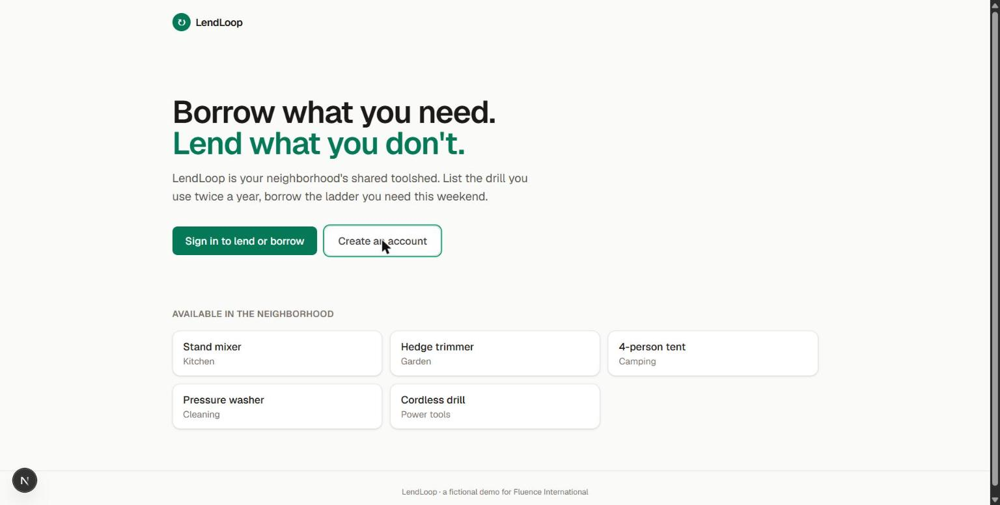
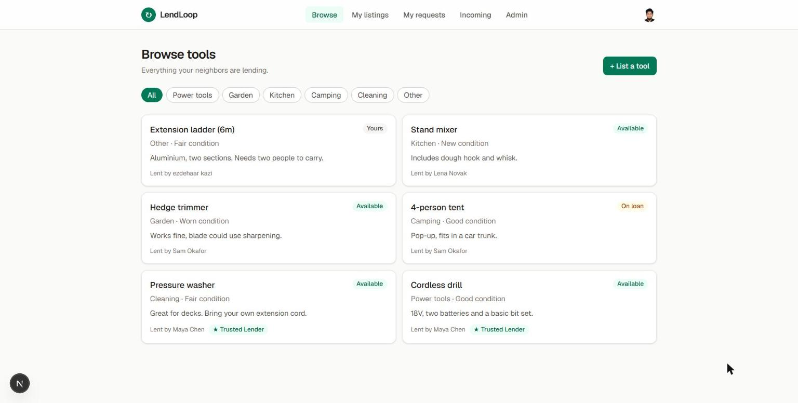
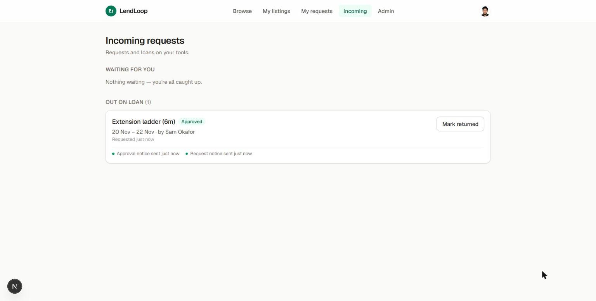
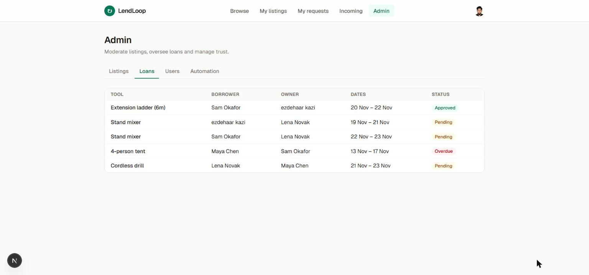
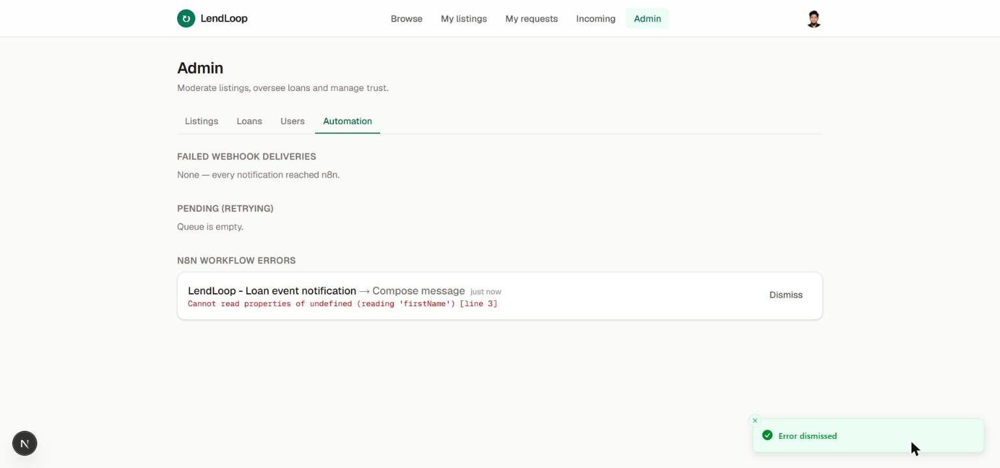
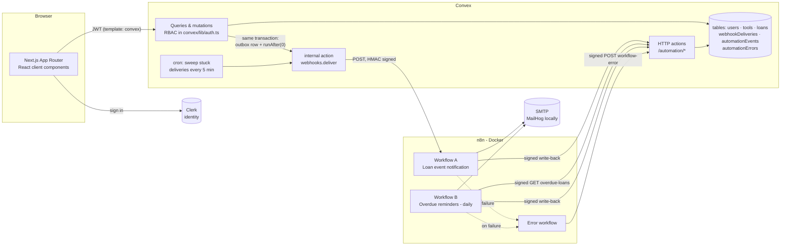
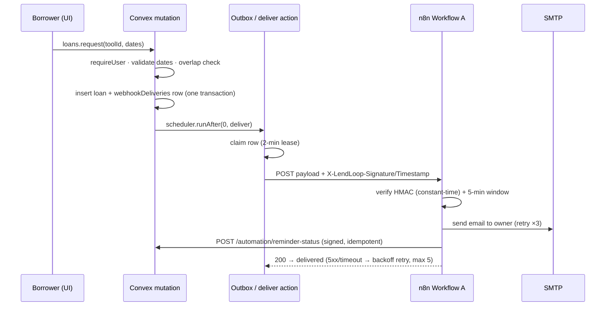

# LendLoop

**Borrow what you need. Lend what you don't.**

LendLoop is a neighborhood tool-lending board. Neighbors list tools, ask to borrow them for a date range, and owners approve or decline. Owners mark loans as returned. n8n sends the notifications and the daily overdue reminders.

Built with **Next.js 16 (App Router, TypeScript strict) · Clerk · Convex · n8n · Tailwind CSS**. Package manager: pnpm.

| Public landing (name + category only) | Browse with availability and Trusted Lender badges |
|---|---|
|  |  |
| **Incoming: approve/decline, live automation activity** | **Admin: all loans, overdue flagged** |
|  |  |
| **Admin → Automation: dead letters, retries, n8n errors** | |
|  | |

---

## Contents

1. [Features](#features)
2. [Architecture](#architecture)
3. [Local setup](#local-setup-step-by-step)
4. [Environment variables](#environment-variables)
5. [Security design](#security-design): RBAC, state machine, webhook signing, data minimization
6. [Reliability design](#reliability-design): outbox, retries, idempotency, error handling
7. [n8n workflows](#n8n-workflows)
8. [Testing & quality](#testing--quality)
9. [Project structure](#project-structure)
10. [Trade-offs & decisions](#trade-offs--decisions)

See [PRODUCTION.md](PRODUCTION.md) for what I'd change before going to production.

---

## Features

**Public (`/`)**: hero, plus a read-only list of available tools showing **name and category only**. It is served by a dedicated public query (`tools.listPublic`) that returns only those fields. A "Sign in to lend or borrow" button opens Clerk.

**Signed in**
- **Browse (`/tools`)**: every tool with its availability (Available / On loan / Yours), filterable by category. A Trusted Lender badge shows on tools from trusted owners.
- **List a tool (`/tools/new`)**: name, category, condition, and a description of up to 280 characters with a live counter.
- **Tool detail (`/tools/[id]`)**: a borrow request form with instant client-side checks that mirror the server rules: start ≥ today, end ≥ start, at most 30 days, no overlap with booked dates.
- **My listings (`/me/listings`)**: edit and delete your own tools. Deleting is refused while a request is pending or a loan is active.
- **My requests (`/me/requests`)**: the status of your requests. You can cancel one while it's still pending.
- **Incoming (`/me/incoming`)**: approve or decline requests on your tools, and mark approved loans as returned. Grouped into *Waiting for you*, *Out on loan* and *History*.
- **Admin (`/admin`)**: remove any listing, view all loans (overdue ones flagged), toggle Trusted Lender on a user, and see automation health: failed or pending deliveries with a **Retry** button, plus n8n workflow errors.
- **Bonus**: every loan card shows its recent automation activity, e.g. "● Approval notice sent just now" or "● Overdue reminder sent 2 days ago". Admins can dismiss handled workflow errors.

**UX**: responsive layout with a mobile menu, skeleton loaders, empty states with a call to action, toasts for every action, and buttons that are disabled while their mutation runs. Destructive actions ask for confirmation inline.

---

## Architecture



**Request lifecycle (Workflow A).**



---

## Local setup (step by step)

**Prerequisites:** Node 22+, pnpm 10+, Docker Desktop.

### 1. Install

```bash
pnpm install
cp .env.example .env.local     # Next.js vars
cp .env.example .env           # docker-compose vars (n8n); only the n8n section matters
```

### 2. Clerk

1. Create an application at <https://dashboard.clerk.com> (Email and/or Google sign-in).
2. **API keys** → copy `NEXT_PUBLIC_CLERK_PUBLISHABLE_KEY` and `CLERK_SECRET_KEY` into `.env.local`.
3. **Integrations → Convex → Activate.** This adds `aud: "convex"` to Clerk session tokens so Convex accepts them. Copy the **Frontend API URL** shown there (e.g. `https://xyz.clerk.accounts.dev`) for step 3.
4. **Sessions → Customize session token**: add these claims so Convex learns the user's name and email. `ADMIN_EMAILS` and notification emails depend on them:

   ```json
   {
     "name": "{{user.full_name}}",
     "given_name": "{{user.first_name}}",
     "email": "{{user.primary_email_address}}"
   }
   ```

> Without step 3 the app loads, but the backend can't verify your session, and the app shows a setup hint. Without step 4 sign-in works, but users show up as "Neighbor" with no email, so they can't be auto-promoted or emailed. The user row refreshes from these claims on the next sign-in or page load.

### 3. Convex

```bash
# 1) Create the deployment (log in + pick a project; writes CONVEX_* to .env.local).
#    The first push stops with "CLERK_JWT_ISSUER_DOMAIN … not set". That's expected: set it next.
npx convex dev --once
#    …or with no Convex account: CONVEX_AGENT_MODE=anonymous npx convex dev --once
#    (local backend on :3210/:3211; keep CONVEX_AGENT_MODE=anonymous set for the commands below)

# 2) Configure it
npx convex env set CLERK_JWT_ISSUER_DOMAIN https://xyz.clerk.accounts.dev
npx convex env set ADMIN_EMAILS you@example.com          # auto-promotes on sign-in
npx convex env set N8N_WEBHOOK_SECRET "$(openssl rand -hex 32)"
npx convex env set N8N_WEBHOOK_URL http://localhost:5678/webhook/lendloop-loan-events

# 3) Run it (leave this terminal open)
npx convex dev
```

### 4. n8n + MailHog

Edit `.env` (the docker-compose file):

```ini
N8N_ENCRYPTION_KEY=<openssl rand -hex 32>
N8N_WEBHOOK_SECRET=<the SAME value you set in Convex>
LENDLOOP_CONVEX_SITE_URL=http://host.docker.internal:3211   # local Convex; or https://<deployment>.convex.site
NOTIFY_MODE=smtp                                            # or "log" for a logged mock
```

```bash
pnpm n8n:up        # docker compose up -d   → n8n http://localhost:5678, MailHog http://localhost:8025
pnpm n8n:import    # imports the SMTP credential + 3 workflows and publishes them
```

On first visit to <http://localhost:5678>, create the n8n owner account. The workflows are already imported and active.

> **Cloud Convex + local n8n:** Convex's servers can't reach `localhost`. Expose n8n with a tunnel (e.g. `cloudflared tunnel --url http://localhost:5678`), set `N8N_WEBHOOK_URL` to `https://<tunnel>/webhook/lendloop-loan-events`, and set `LENDLOOP_CONVEX_SITE_URL=https://<deployment>.convex.site` in `.env`.
>
> **Windows Git Bash:** prefix docker commands with `MSYS_NO_PATHCONV=1` so container paths aren't rewritten.

### 5. Run the app

```bash
pnpm dev           # http://localhost:3000
pnpm seed          # optional demo data: 3 neighbors, 5 tools, 1 pending request, 1 overdue loan
pnpm seed --admin you@example.com   # promote an already-signed-in user without ADMIN_EMAILS
```

### 6. See the automations

- **Workflow A**: request a tool as one user. The owner's email shows up in MailHog, and "Notification sent just now" appears on the loan.
- **Workflow B**: it runs daily at 09:00 UTC. To trigger it now: `pnpm n8n:run-overdue` (or open the workflow and click *Execute*). The seeded overdue loan gets a reminder email. Run it again and nothing is sent, because the loan was already reminded today.
- **Failure path**: `docker compose stop mailhog`, then make a request. n8n retries the SMTP send 3×, writes back `failed`, and answers 502. Convex retries with backoff (visible under Admin → Automation). `docker compose start mailhog` and the next retry delivers; the event flips to `sent`.

---

## Environment variables

| Variable | Where | Purpose |
|---|---|---|
| `CONVEX_DEPLOYMENT`, `NEXT_PUBLIC_CONVEX_URL`, `NEXT_PUBLIC_CONVEX_SITE_URL` | `.env.local` | Written by `npx convex dev`. |
| `NEXT_PUBLIC_CLERK_PUBLISHABLE_KEY` | `.env.local` | Clerk frontend key. |
| `CLERK_SECRET_KEY` | `.env.local` | Clerk server key (used by `proxy.ts`). Never exposed to the browser. |
| `CLERK_JWT_ISSUER_DOMAIN` | Convex env | Clerk Frontend API URL; Convex trusts JWTs from this issuer with `aud=convex`. |
| `ADMIN_EMAILS` | Convex env | Comma-separated. A user with a **verified** matching email is promoted to admin on sign-in. It only ever promotes, never demotes. |
| `N8N_WEBHOOK_URL` | Convex env | Workflow A webhook URL, as reachable **from Convex**. |
| `N8N_WEBHOOK_SECRET` | Convex env **and** `.env` | Shared HMAC key (≥32 random bytes). n8n sees it as `$env.LENDLOOP_WEBHOOK_SECRET`. |
| `N8N_ENCRYPTION_KEY` | `.env` | Encrypts credentials stored in n8n's database. |
| `LENDLOOP_CONVEX_SITE_URL` | `.env` | Convex HTTP-actions base URL, as reachable **from the n8n container**. |
| `NOTIFY_MODE` | `.env` | `smtp` (default, uses the SMTP credential) or `log` (mock: logs a redacted address). |
| `NOTIFY_FROM` | `.env` | From address for notification emails. |

---

## Security design

### Authentication
Clerk issues the session. `ConvexProviderWithClerk` passes a Clerk JWT (template `convex`) to Convex, which validates the issuer and audience (`convex/auth.config.ts`). `proxy.ts` (Next 16's middleware) redirects signed-out users away from `/tools`, `/me` and `/admin`. That redirect is **for UX only**.

### Authorization (RBAC) is enforced in Convex
All checks live in [`convex/lib/auth.ts`](convex/lib/auth.ts) and run inside every query and mutation:

| Helper | Guarantees |
|---|---|
| `requireUser(ctx)` | Valid identity. In mutations the `users` row is upserted on first call; queries are read-only and treat a missing row as signed out. |
| `requireAdmin(ctx)` | `role === "admin"` on the **server-side** user row. |
| `requireToolOwner(ctx, toolId)` | The tool exists, isn't deleted, and belongs to the caller. |
| `requireLoanParty(ctx, loanId, "owner" \| "borrower" \| "either")` | The caller is that party on the loan. `ownerId` is denormalized onto `loans`, so this costs one read. |

| Action | Who | Function |
|---|---|---|
| Create/edit/delete listing | owner | `tools.create / update / remove` |
| Request to borrow | any user (not on own tool) | `loans.request` |
| Approve / decline / mark returned | tool owner | `loans.approve / decline / markReturned` |
| Cancel | borrower, only while `requested` | `loans.cancel` |
| Read loans | own only | `loans.listMine / listIncoming` |
| Remove any listing, list all loans/users, Trusted Lender, retry deliveries | admin | `admin.*` |

More details:
- **Role is never accepted from the client.** It defaults to `user`. Promotion happens only via `ADMIN_EMAILS` (verified emails only) or the internal mutation `users:setRoleByEmail`, which can only be run from the CLI or dashboard.
- "Not found" and "not yours" return the **same error**, so IDs can't be probed.
- Every mutation validates arguments with `v.*` validators. Text is trimmed and length-checked server-side. Dates are strictly parsed as `YYYY-MM-DD` and real calendar days (rejecting things like `2026-02-30`).
- The UI hides controls the user can't use, but that is never the enforcement point. The tests call mutations directly as the wrong user.

### Loan state machine
[`convex/lib/loanState.ts`](convex/lib/loanState.ts) is a single transition table:

```
requested → approved | declined | cancelled
approved  → returned
declined, returned, cancelled → (terminal)
```

Every status change goes through `assertTransition`. A test enumerates all 25 pairs, so a new transition can't slip in by accident. Approval also **re-checks overlap** against already-approved loans, which catches the race where two overlapping requests are approved one after the other.

### Webhook signing & verification
One scheme for every hop, implemented in [`convex/lib/hmac.ts`](convex/lib/hmac.ts) (Web Crypto) and mirrored in the n8n Code nodes (`node:crypto`):

```
signature = hex( HMAC-SHA256( secret, `${timestamp}.${rawBody}` ) )
headers:   X-LendLoop-Signature: <hex>    X-LendLoop-Timestamp: <unix seconds>
```

- **Raw bytes are signed.** Convex stores the exact JSON string in the outbox and signs that string. n8n's webhook node uses `rawBody: true` and verifies the raw bytes, not a re-serialized object.
- **Constant-time compare**: `crypto.timingSafeEqual` in n8n, and an XOR-accumulate compare in Convex.
- **Replay protection**: requests whose timestamp is more than 5 minutes from now are rejected in both directions. The timestamp is inside the MAC, so it can't be altered.
- **Fail closed**: missing secret, missing or malformed headers, stale timestamp and bad MAC all return a generic `401`. The reason is logged server-side only.
- A unit test pins a known vector produced by `node:crypto`, proving the two implementations agree.
- For the signed GET (`/automation/overdue-loans`) the body is empty, so the MAC covers `timestamp + "."`.
- Inbound HTTP bodies are capped at 16 KB.

### Data minimization
- **Public page**: `tools.listPublic` returns `{_id, name, category}` only. No owner, description or availability.
- **Webhook payload** (Convex → n8n): `event, deliveryKey, loanId, toolName, status, recipient {email, firstName}, startDate, endDate`. No descriptions, no counterparty details, no internal user IDs, no last names. A test asserts the exact key set.
- **Overdue feed** (n8n ← Convex): `loanId, toolName, endDate, daysOverdue, borrower {email, firstName}, idempotencyKey`.
- **Authenticated views** expose only the counterparty's display name, never their email. Emails are visible to admins only.
- **n8n**: successful Workflow A executions aren't saved (`saveDataSuccessExecution: none`), execution data is pruned after 7 days, and the mock mailer logs `ma***@domain`.
- **Error reports** sent to Convex carry only workflow, node, message and execution id.

### Secrets
- Every secret lives in env: `.env.local`, Convex env, or n8n's container env. Workflow JSON references secrets as `$env.LENDLOOP_WEBHOOK_SECRET`. The SMTP credential is referenced by id. The committed MailHog credential has no password.
- [`scripts/check-workflow-secrets.ts`](scripts/check-workflow-secrets.ts) (`pnpm check:secrets`, run in CI) scans n8n JSON for:
  - exact values of known secret env vars;
  - key and token patterns: private keys, JWTs, `sk_`/`pk_` keys, AWS, Slack and GitHub tokens, bearer tokens, URLs with embedded credentials, long hex or base64 blobs;
  - non-empty values under sensitive keys (`password`, `secret`, `token`, `apiKey`…).
  
  I ran it against a fresh `n8n export:workflow` and the export passed. It correctly **fails** on `n8n export:credentials` output, which should never be committed.
- n8n ports bind to `127.0.0.1` only.

---

## Reliability design

### Transactional outbox (Convex → n8n)
1. A loan mutation inserts a `webhookDeliveries` row **in the same transaction** as the status change, then calls `ctx.scheduler.runAfter(0, internal.webhooks.deliver)`. If the mutation fails, neither the change nor the webhook happens. A committed change always has a delivery row.
2. `deliver` first **claims** the row (`pending` and due), taking a 2-minute lease, and then POSTs with a 30 s timeout.
3. `2xx` → `delivered`. Anything else (non-2xx, timeout, network error, missing config) → `recordFailure`:
   - increments `attempts`;
   - schedules a retry with **exponential backoff and jitter** (30 s, 60 s, 120 s… capped at 1 h);
   - after **5 attempts** marks the row `failed`, which works as a dead letter: it shows in Admin → Automation with a **Retry** button.
4. **Sweeper cron** (every 5 minutes) re-drives `pending` rows whose lease or backoff has expired. This covers an action that crashed mid-flight, since scheduled actions run at most once. The lease makes double-scheduling harmless.

The Convex timeout (30 s) is deliberately longer than n8n's worst case (3 SMTP tries plus waits). That way Convex sees n8n's `502` instead of timing out while n8n is still trying.

### Idempotency
- `automationEvents.idempotencyKey` has an index and is **checked and inserted in one serializable Convex transaction**, so it behaves as a unique constraint. Convex has no native unique index, and concurrent duplicates can't both insert.
- Overdue reminders use the key `"<loanId>:<YYYY-MM-DD>"`. Request notifications use `deliveryKey = "<loanId>:<status>"`, which is stable across outbox retries.
- A duplicate write-back returns **200** with `duplicate: true` and creates no record, so n8n's own retries never turn into errors. One exception: a later `sent` may upgrade an earlier `failed` in place.
- The key must start with the given `loanId`, so a caller can't use up another loan's key.
- Beyond the write-back, **re-running Workflow B the same day sends nothing**: the overdue feed skips loans whose reminder for today is already `sent`.

### Error handling in n8n
- **Retry On Fail** (3 tries, 2–5 s between tries) on every HTTP Request and Send Email node. n8n's built-in retry waits a fixed time; the exponential layer is Convex's outbox.
- Send Email uses an **error output**. A failed send writes back `status: failed` with a short error message, and Workflow A answers `502` so Convex retries.
- Invalid signatures are answered with `401` and deliberately **don't** trigger the error workflow. Otherwise anyone could flood the alerts.
- **Error workflow** (`LendLoop - Error handler`) is set as `errorWorkflow` on A and B. On any unhandled failure it logs to the container output and POSTs a signed report to `/automation/workflow-error`. The report shows under Admin → Automation → *n8n workflow errors*. Nothing fails silently.

I ran all of this against the running stack:
- happy path;
- unsigned, stale and tampered requests (all `401`);
- SMTP down: `failed` write-back, `502`, Convex backoff, recovery on attempt 4, event upgraded to `sent`;
- a malformed but correctly signed payload, which triggered the error workflow and was recorded in Convex.

---

## n8n workflows

Exported in [`n8n/workflows/`](n8n/workflows/). Imported with `pnpm n8n:import`.

After editing a workflow in the n8n UI, run **`pnpm n8n:export`**. It exports from the running container and strips instance-specific data: project/owner info in `shared`, timestamps, version ids, pinned data. It then writes the files and runs `pnpm check:secrets`, so a secret can't be committed by accident.

| File | Trigger | Flow |
|---|---|---|
| `request-notification.json` | Webhook `POST /webhook/lendloop-loan-events` | Verify signature → valid? (no → 401) → compose message → SMTP or mock → sign write-back (`sent` / `failed`) → POST `/automation/reminder-status` → 200 / 502 |
| `overdue-reminders.json` | Schedule, daily 09:00 UTC (+ manual trigger) | Sign request → GET `/automation/overdue-loans` → split per loan → compose reminder → SMTP or mock → sign write-back → POST `/automation/reminder-status` |
| `error-handler.json` | Error Trigger | Build report (workflow, node, message, execution id) + `console.error` → sign → POST `/automation/workflow-error` |

The container gets `NODE_FUNCTION_ALLOW_BUILTIN=crypto`, so Code nodes can `require('crypto')`. It also gets `N8N_BLOCK_ENV_ACCESS_IN_NODE=false` so they can read `$env`. See PRODUCTION.md for the hardened alternative (external secrets).

---

## Testing & quality

```bash
pnpm lint        # ESLint (next/core-web-vitals + typescript; no-explicit-any = error)
pnpm typecheck   # tsc --noEmit, strict
pnpm test        # Vitest + convex-test (52 tests)
pnpm check:secrets
```

The test suites:
- [`convex/lib/loanState.test.ts`](convex/lib/loanState.test.ts): every transition pair.
- [`convex/lib/pure.test.ts`](convex/lib/pure.test.ts):
  - date rules (past start, end before start, more than 30 days, invalid calendar days, inclusive overlap);
  - HMAC (known vector, tampering, wrong secret, stale timestamp, missing headers);
  - the backoff curve.
- [`convex/auth.test.ts`](convex/auth.test.ts): `requireUser` / `requireAdmin` / `requireToolOwner` / `requireLoanParty`, called both directly and through real mutations as the wrong user; `ADMIN_EMAILS` bootstrap (including unverified email); server-side validation.
- [`convex/loans.test.ts`](convex/loans.test.ts): the full loan flow, overlap blocking (including at approval time), delete guards, admin removal, automation activity, outbox payload minimization, and delivery with retry (fetch mocked, 5 attempts then `failed`).
- [`convex/http.test.ts`](convex/http.test.ts): signed endpoints (unsigned, wrong key, stale, tampered), minimized overdue feed, idempotent write-back, failed→sent upgrade, error recording.

CI (`.github/workflows/ci.yml`) runs lint, typecheck, tests and the secret check.

---

## Project structure

```
app/                       Next.js routes
  page.tsx                 public landing (hero + public tool list)
  (app)/                   authenticated group (nav + auth gate)
    tools/ tools/new/ tools/[id]/
    me/listings/ me/requests/ me/incoming/
    admin/
components/                UI primitives (ui.tsx), forms, cards, nav, providers
lib/                       client helpers: formatting, useAction (pending + toasts)
convex/
  schema.ts                tables + indexes
  lib/auth.ts              RBAC helpers         lib/loanState.ts  state machine
  lib/hmac.ts              signing/verification lib/outbox.ts     payload + enqueue + backoff
  lib/dates.ts             date rules           lib/validators.ts shared enums/validators
  tools.ts loans.ts admin.ts users.ts           public API (queries/mutations)
  webhooks.ts              outbox delivery action, claim/lease, retries, sweeper
  automation.ts            internal fns behind the HTTP endpoints
  http.ts                  /automation/* signed HTTP routes
  crons.ts seed.ts
n8n/workflows/             exported workflow JSON (3)
n8n/credentials/           MailHog SMTP credential (no secrets)
scripts/                   seed.ts, check-workflow-secrets.ts (+ test)
docker-compose.yml         n8n 2.48 (+ volume) and MailHog
proxy.ts                   Clerk route protection (Next 16 "proxy", formerly middleware)
```

---

## Trade-offs & decisions

- **Dates are UTC calendar days stored as `YYYY-MM-DD` strings.** They compare lexicographically, index well (`by_status_endDate`), and avoid time-zone drift for a day-granularity domain. The client uses UTC "today" too, so its validation matches the server's.
- **Only `approved` loans block the calendar.** Several neighbors may request overlapping dates; the owner picks one, and approval re-checks overlap.
- **Soft delete for tools** (`deletedAt`), so both parties and admins keep loan history. When an admin removes a listing, its pending requests are declined (and the borrowers notified); approved loans stay so the return can still be tracked.
- **Notification recipient by event**: `requested` and `cancelled` go to the owner; `approved`, `declined` and `returned` go to the borrower.
- **Extra table `automationErrors`** beyond the brief's schema. Workflow-level failures (for example, a crash before a loan is even known) have no `loanId`, so they don't fit `automationEvents`.
- **Convex HTTP and scheduler instead of a queue service.** The outbox, lease, backoff and sweeper give at-least-once delivery with dedupe keys and need no extra infrastructure. PRODUCTION.md covers when I'd change that.
- **List queries use `.collect()` or `.take(500)`.** That's fine at neighborhood scale. At larger scale I'd paginate (`usePaginatedQuery`) and denormalize "on loan now" onto `tools`.
